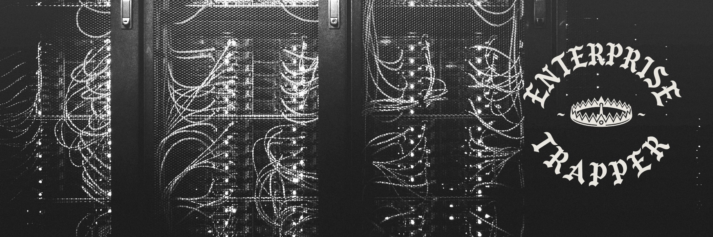
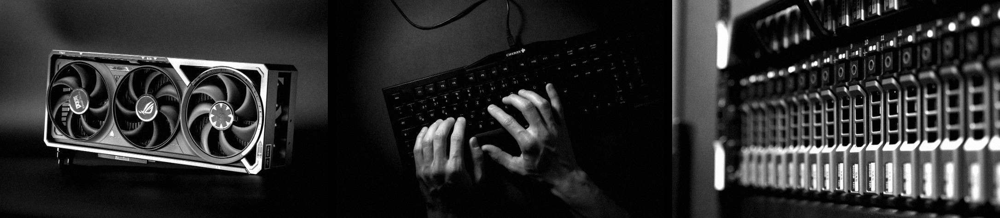

  

 

<strong>THE WORK</strong>

  I build things that should already exist. 
  No noise. No permission. 
  Just the work.

 

  

 

<strong>IN THE LAB</strong>

  Anotch. 
  An AI workspace that lives in the MacBook notch. 
  Out when it's right. Not before.

 

<strong>HOUSE RULES</strong>

  Build what should already exist. 
  Sweat the details. 
  Ship it. Then sharpen it.

 

<strong>BACK THE BENCH</strong>

  Every coffee funds another late night. 
  <a href="https://buymeacoffee.com/enterprisetrapper">Buy the next one.</a>

 

  <picture>
    <source media="(prefers-color-scheme: dark)" srcset="assets/emblem-dark.png" />
    <source media="(prefers-color-scheme: light)" srcset="assets/emblem-light.png" />
    
  </picture>

ENTERPRISE TRAPPER

